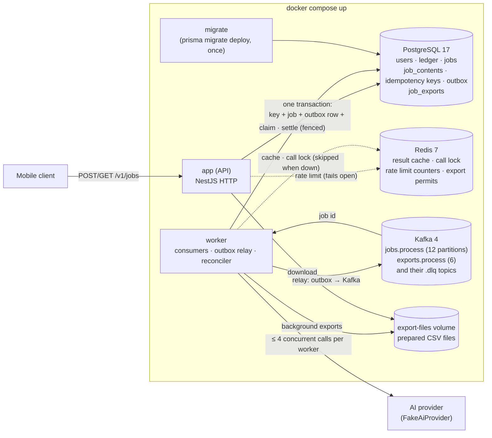
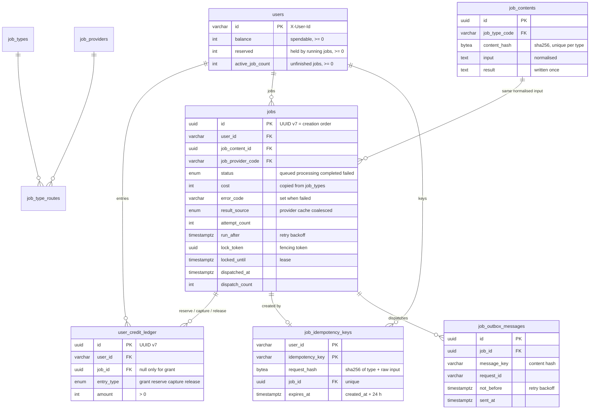
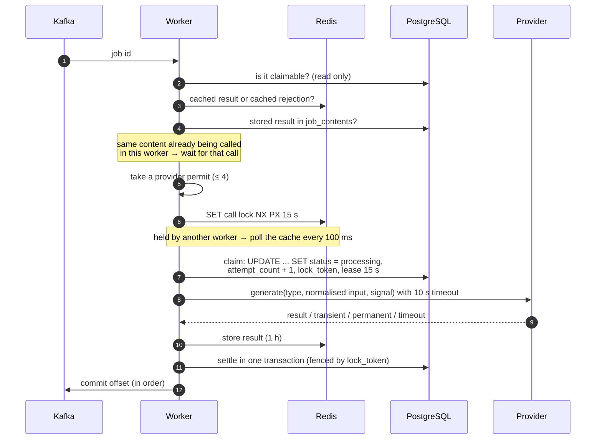
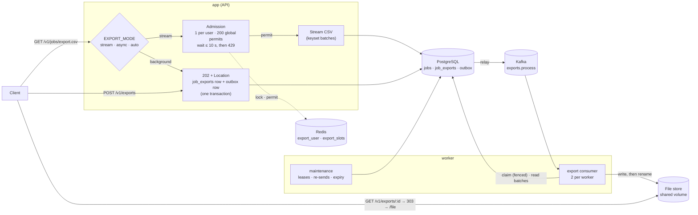

# Design

How the service keeps credits correct, survives crashes and retries, and bounds its resource use. The README is the short version; this document has the reasons and the details. Every claim here is checked by a test or by the verification run in [section 12](#12-verification).

## 1. Principles

1. **PostgreSQL is the source of truth.** Balances, the ledger, job state and idempotency keys live there. Correctness comes from three things only: unique and check constraints, single-statement conditional updates, and transactions that write a state change together with its consequences.
2. **Kafka moves work, it does not own it.** A message only says "look at job X". The job's state is in the `jobs` table, so a lost, duplicated or reordered message cannot change an outcome.
3. **Redis only saves work and spreads limits.** Result cache, cross-worker call lock, rate limit counters and export permits. If Redis is down, the system calls the provider more often and limits exports per instance; it never charges wrongly or loses a job.
4. **Every worker write is fenced.** A worker changes a job only while it holds the job's `lock_token`. A worker that lost its lease can no longer write anything.

## 2. Components



| Service | Entry point | Does |
|---|---|---|
| `app` | `src/main.ts` | Creates and queries jobs, streams the CSV export (or accepts it as a background export), serves prepared export files, grants credits. Never talks to Kafka. |
| `worker` | `src/worker.ts` | Consumes `jobs.process`, calls the provider, settles jobs. Consumes `exports.process` and writes export files (section 16). Also runs the outbox relay, the reconciler, export maintenance and idempotency key cleanup. Scale with `--scale worker=N`. |
| `migrate` | `prisma migrate deploy` | Applies migrations once, before `app` and `worker` start. |
| `kafka-init` | `kafka-topics.sh` | Creates the four topics and exits. |
| `seed` | `tools` profile | 500,000-job seed. Not started by `docker compose up`. |

### Why Kafka with an outbox

A database-backed queue would have been enough for the case's volume, and its main property (the job and its queue entry in one transaction) is kept here through the outbox. Kafka was chosen for what comes after the case: many worker pods sharing work through consumer groups, replay, and routing jobs with the same content to the same worker (the message key is the content hash), which turns most duplicate provider calls into in-process sharing.

The cost is two extra moving parts, and both are covered:

- **Dual write.** The API writes the job and an outbox row in one transaction. The relay (in the worker, every 200 ms) publishes rows with `FOR UPDATE SKIP LOCKED` and marks them sent after Kafka acknowledges. A crash in between publishes a row twice, which consumers tolerate.
- **Lost or stuck messages.** The reconciler (section 6) re-dispatches any job that sits in `queued` too long and requeues any job whose worker stopped heartbeating. The queue can lose a message; the system cannot lose a job.

## 3. Data model



**Job configuration is data.** `job_types` (price, input limit, attempts, timeout, cache TTL), `job_providers` and `job_type_routes` are seeded by a migration with the case's values (summary 3 credits, translate 1, 20,000 characters, 3 attempts, 10 s, 1 h). The API reloads them every 30 s. A job copies its cost, provider and model when it is created, so a price change never affects an accepted job.

**Inputs are stored once.** Jobs with the same type and normalised input share a `job_contents` row. Its `content_hash` covers type, prompt version, provider, model and normalised input, so a new model or prompt never reuses an old answer. The row's `result` is written once (first writer wins) and is also the durable copy behind the Redis cache.

### Balance model

Two counters per user, and every change is one ledger entry with a positive amount:

| Entry | `balance` | `reserved` | When |
|---|---|---|---|
| `grant` | + n | | Credits added |
| `reserve` | − n | + n | Job accepted |
| `capture` | | − n | Job completed (from the provider or a stored result) |
| `release` | + n | − n | Job failed for good |

Invariants, checked by the tests and by `verify balances` on the running stack:

```
balance  = Σ grant − Σ reserve + Σ release
reserved = Σ reserve − Σ capture − Σ release
```

Each counter update and its ledger entry are a single SQL statement (`WITH ... UPDATE ... RETURNING` feeding `INSERT`), so they cannot drift apart.

### Constraints and why

| Constraint | Why |
|---|---|
| `users`: `balance >= 0`, `reserved >= 0`, `active_job_count >= 0` | The balance cannot go negative even if application code is wrong. |
| `user_credit_ledger`: `amount > 0` | Direction comes from `entry_type`; a signed amount would allow a second way to express the same thing. |
| `user_credit_ledger`: `(entry_type = 'grant') = (job_id IS NULL)` | Every movement except a grant belongs to a job. |
| `UNIQUE (job_id) WHERE entry_type = 'reserve'` | One reservation per job. |
| `UNIQUE (job_id) WHERE entry_type IN ('capture','release')` | **A reservation is settled at most once**, by capture or release, never both. If two workers ever both tried, the second transaction fails and rolls back. |
| `job_idempotency_keys`: primary key `(user_id, idempotency_key)` | Concurrent requests with one key: exactly one inserts, the others wait on the index entry. |
| `job_idempotency_keys`: `UNIQUE (job_id)`, FK `DEFERRABLE INITIALLY DEFERRED` | One key per job. Deferred so the key can be claimed before the job row exists (section 4). |
| `job_contents`: `UNIQUE (job_type_code, content_hash)` | One row per distinct input; concurrent creators upsert into it. |
| `jobs`: `status <> 'failed' OR error_code IS NOT NULL`, `status <> 'completed' OR result_source IS NOT NULL` | A finished job always says how it finished. |
| `jobs`: `status <> 'processing' OR (lock_token AND locked_until)` | A processing job always has an owner and a lease, so the reconciler can always recover it. |
| `jobs`: `(status IN ('completed','failed')) = (finished_at IS NOT NULL)` | `finishedAt` in the API is never inconsistent with the status. |
| `job_contents`: `(result IS NULL) = (result_at IS NULL)`, `octet_length(content_hash) = 32` | Shape checks; cheap and catch bugs early. |

### Indexes

| Index | Used by |
|---|---|
| `jobs (user_id, id DESC)` | `GET /v1/jobs` without status, CSV export |
| `jobs (user_id, status, id DESC)` | `GET /v1/jobs?status=` |
| `jobs (locked_until) WHERE status = 'processing'` | Reconciler: expired leases. Partial, so it stays as small as the number of running jobs. |
| `jobs (dispatched_at) WHERE status = 'queued'` | Reconciler: jobs nobody picked up. |
| `job_outbox_messages (not_before) WHERE sent_at IS NULL` | Relay: unsent rows only. |
| `job_outbox_messages (sent_at) WHERE sent_at IS NOT NULL` | Cleanup of rows sent more than an hour ago. |
| `job_idempotency_keys (expires_at)` | Cleanup of expired keys. |
| Every foreign key leads an index (its own, or a composite or primary key) | Deletes and joins on the referenced tables. |

There is no `created_at` index: ids are UUID v7, so `ORDER BY id DESC` is newest first, and the cursor is the last id (`id < cursor`), with no `OFFSET`.

## 4. Creating a job

`POST /v1/jobs` runs one `READ COMMITTED` transaction. The order is deliberate:

1. **User exists?** A user who never received credits gets 402 before anything is written.
2. **Claim the key.** `INSERT INTO job_idempotency_keys ... ON CONFLICT DO NOTHING RETURNING job_id`. A second request with the same key blocks on the primary key until the first commits or rolls back, so it does no work in the meantime. Then:
   - the first committed: same body hash → return its `jobId` (replay, 202); different hash → 422 `idempotency_key_reused`;
   - the first rolled back (for example 402): the claim is retried and this request proceeds;
   - the key is older than 24 h: it is deleted in the same transaction and claimed again.
3. **Upsert the content**, insert the job, write the outbox row.
4. **Reserve last.** One statement: `UPDATE users SET balance = balance − cost, reserved = reserved + cost, active_job_count = active_job_count + 1 WHERE id = $1 AND balance >= cost AND active_job_count < 50`, whose `RETURNING` feeds the `reserve` ledger insert. Zero rows → 402 `insufficient_credits` (or 429 `too_many_active_jobs`) and the whole transaction, including the key, rolls back. The user row is locked last so the lock all of a user's requests compete for is held only until commit.

Why it holds under concurrency:

- **(a) 10 concurrent requests, same key and body.** Only one transaction can insert the key. The other nine wait on it, then read the committed row and return the same `jobId`. One job, one `reserve`.
- **(b) Balance 5, five concurrent 3-credit requests.** The conditional `UPDATE` re-checks `balance >= 3` after acquiring the row lock (PostgreSQL re-evaluates the `WHERE` on the newest row version). The first leaves 2; the other four match zero rows and get 402. There is no read-then-write gap to race in.
- **A 402 leaves no trace,** so the client can top up and retry with the same key.

`active_job_count` caps unfinished jobs per user (default 50). It bounds how much one client can queue and keeps the queue's size a function of users, not of one user's loop.

## 5. Worker

### Delivery and concurrency

- `jobs.process` has 12 partitions; the message key is the content hash, so jobs with the same input go to the same worker.
- Inside a partition, messages are handled **concurrently**, not one by one, so a 5-second `slow` job does not hold up the jobs behind it. Offsets are committed in order: an offset is committed only when it and every message before it are done (at most 1,000 uncommitted per partition). The worker holds at most `WORKER_JOB_CONCURRENCY` (500) messages at once across partitions; beyond that it takes no new message until one finishes, and Kafka prefetches at most 50 messages or 1 MB per partition. Each message is a job id, so memory is bounded by these two numbers, never by the queue length.
- Provider calls are limited per worker by a semaphore of `WORKER_PROVIDER_CONCURRENCY` (4). Every provider call logs `concurrent` and `maxConcurrent` (a wrapper around every adapter). A call is awaited through `untilAborted`, so its 10 s timeout holds even for an adapter that ignores the abort signal.
- A message that is not valid JSON or has no job id goes to `jobs.process.dlq` with its source partition and offset. A handler error (database down) is retried in place with backoff from 1 s to 30 s.

### Processing one job



**The job is claimed late,** right before the provider call, or once its outcome is known without one (cache hit, coalesced result). A job waiting for a permit holds no lease and writes nothing, so a backlog behind the 4 permits costs no database work, and a job abandoned during shutdown is simply delivered again.

While claimed, a heartbeat extends the lease every 5 s. If the extension finds the lease gone (another worker took over), the call is aborted: its outcome could not be written anyway.

**Settlement** is one transaction per outcome, and every statement requires `lock_token`:

| Outcome | Writes |
|---|---|
| Completed | `jobs` → `completed` + `result_source`, `job_contents.result` (if not set), `capture` |
| Permanent error (`fail…`) | `jobs` → `failed` (`provider_rejected`), `release`. The rejection is cached for 5 min. |
| Transient error or timeout, attempts left | `jobs` → `queued`, `run_after` = the database's `now()` + 1 s, 2 s, … (+ up to 250 ms jitter), and an outbox row with `not_before = run_after` |
| Transient error or timeout, 3rd attempt | `jobs` → `failed` (`provider_unavailable` / `provider_timeout`), `release` |
| Interrupted by shutdown | `jobs` → `queued`, the attempt is not counted, new outbox row |

If the settlement transaction fails three times (database outage), the job keeps its lease until it expires and the reconciler takes over.

### Result cache and one call for 20 identical jobs

Normalisation: Unicode NFC, trim, lowercase, collapse whitespace. A job looks for its result in this order, and only the last step calls the provider:

1. the Redis result (`job_result:<content hash>`, 1 h TTL) or a cached rejection;
2. the stored result in `job_contents` (Redis lost or evicted it; it is put back);
3. a call for the same content already running **in this worker** (an in-memory map of promises);
4. a call already running **in another worker** (the Redis call lock; the follower polls the cache);
5. its own call.

For test (c), the 20 jobs share a content hash, so they land on one partition and one worker: one leads, 19 wait on its promise or read its result from the cache. Every one of them captures its credits (the case's product decision). `result_source` records which path each job took.

## 6. Crashes, the reconciler and shutdown

**Worker killed mid-job** (`docker compose kill worker` during `slow deneme`):

1. The job stays `processing` with a lease that is no longer extended; no ledger entry was written.
2. Within 15 s the lease expires, and a reconciler requeues the job with a new outbox row. The uncommitted Kafka message is delivered again too, but it can claim the job only once the lease has expired (`locked_until < now()` makes it claimable); arriving earlier, it is skipped and committed.
3. The new attempt runs with a new `lock_token`. If the dead worker's provider call had finished and stored its result in Redis, the new attempt reuses it instead of calling again.
4. One `capture`. The partial unique index makes a second one impossible.

A crash counts as an attempt, so an input that crashes the worker every time fails after 3 attempts (`worker_lost`) and is refunded instead of looping forever.

**The reconciler** runs every 5 s in every worker; `FOR UPDATE SKIP LOCKED` keeps two of them off the same row, and each change re-checks the condition that selected the row:

- `processing` with an expired lease → back to `queued` with a new outbox row, or `failed` + `release` if that was the last attempt;
- `queued`, and its last message not received by any worker for 2 minutes → sent again. The wait doubles with every send nobody received (2, 4, 8 … minutes, at most 1 hour), so a backlog is not flooded with copies of its own jobs. A job is never failed for this: a slow queue is not a lost job. A worker that receives a job's message records it (`dispatch_count = 0`), so a job waiting in a worker for a provider permit is left alone; if that worker dies, Kafka delivers the uncommitted message again.

Together these guarantee that every accepted job reaches a worker and ends `completed` or `failed`, and every reservation is captured or released.

**SIGTERM:**

1. Pause consumption; jobs not claimed yet stop waiting and their offsets stay uncommitted, so they are redelivered to another worker.
2. Claimed jobs get `WORKER_SHUTDOWN_GRACE_MS` (25 s) to finish. Compose gives the worker 30 s (`stop_grace_period`).
3. Jobs still running are aborted and returned to `queued` without counting the attempt.
4. Commit the offsets of the messages that finished, leave the consumer group and exit.

The database, Redis and Kafka producer connections close only after these steps (NestJS's last shutdown hook), so jobs finishing in the grace period still store their result, settle their credits and publish their retries.

## 7. Delivery guarantee

**At-least-once processing, exactly-once credit effect.** Messages can be duplicated (relay crash, consumer redelivery) and are filtered by the claim. The provider can be called twice for the same job when:

1. the worker dies after the provider answered and **before the result reached Redis** (or the Redis write failed); the next attempt calls again. A settlement that fails after that finds the result in Redis on the next attempt;
2. a worker stalls longer than its lease (15 s) while its call is running, the job is taken over, and the call lock (provider timeout + 5 s, restarted when the call starts) has also expired;
3. Redis is down: there is no cross-worker call lock or cache, so if a rebalance moves a partition mid-call, two workers can call for the same content;
4. retries after transient errors, by design.

In all of these only the worker holding the current `lock_token` can settle, and the first stored result is the one every job of that content gets.

## 8. Redis outage

| Use | During the outage |
|---|---|
| Result cache, cached rejections | Skipped. Stored results in `job_contents` still prevent repeat calls for known inputs. |
| Cross-worker call lock | Skipped. Same-content jobs still share a call inside one worker (same partition). |
| Rate limit | Fails open: requests are allowed, one warning per minute is logged. |
| Streamed export permits | Each instance limits itself to `EXPORT_FALLBACK_MAX_CONCURRENT` (20) instead of the shared limit (section 16). |
| Idempotency, queue, credits | Not affected: PostgreSQL and Kafka. |
| `/health` | `200` with `"status": "degraded"`; `503` only when the database is down. |

The Redis client does not queue commands while disconnected and has a short command timeout, so an outage costs a fast failure, not a hang.

## 9. Queries

| Endpoint | Notes |
|---|---|
| `GET /v1/jobs/:id` | `WHERE id = $1 AND user_id = $2`. Another user's job or a malformed id → 404, so ids cannot be probed. |
| `GET /v1/jobs?status=&limit=&cursor=` | Newest first, keyset on `id`, `limit` 1–100 (default 20), `nextCursor` when more exist. An empty parameter counts as not given, so the URL exactly as written here returns the first page. |
| `GET /v1/jobs/export.csv` | Below; with `EXPORT_MODE=async` or `auto` it can answer 202 with a background export (section 16). |
| `POST /v1/exports`, `GET /v1/exports/:id`, `GET /v1/exports/:id/file`, `DELETE /v1/exports/:id` | Background exports: request (202, `Location`, `Retry-After`), poll (200, or 303 to the file once ready), download, cancel. Section 16. |
| `POST /internal/users/:id/credits` | `{ "amount": n }`; creates the user on first grant, writes a `grant` entry. A grant that would take balance + reserved past the INTEGER maximum is refused (422 `balance_limit_exceeded`), so no later release can overflow. |
| `GET /internal/users/:id/credits` | `{ userId, balance, reserved }`. Not required by the case; makes the verification flow checkable. |

All errors are RFC 9457 problem documents with the case's `error` value (`insufficient_credits`, `idempotency_key_reused`, …) and a `requestId`. The OpenAPI document is in `docs/api/openapi.json`, Swagger UI at `/docs`.

### CSV export

The export reads 1,000 rows at a time with short keyset queries (`WHERE user_id = $1 AND id < $last ORDER BY id DESC LIMIT 1000`) and writes each batch to the response:

- **Memory:** at most one batch in memory for any number of jobs.
- **Backpressure:** when `res.write()` returns `false`, the loop waits for `drain` before reading the next batch. A client reading at 50 KB/s makes the server read at 50 KB/s.
- **Disconnect:** `close` stops the loop, also when it comes while a batch is being read (the loop does not wait for a `drain` that a closed response never sends). Nothing stays open between batches, so there is no cursor or transaction to clean up; the batch query in flight, if any, finishes in milliseconds.
- **Why not a server-side cursor:** a cursor needs one transaction for the whole download. A slow client would hold a connection and an old snapshot for minutes, which blocks vacuum on `jobs` for everyone. Keyset batches give the same memory profile without that.
- A database error mid-file destroys the connection, so the client never sees a truncated file as complete.
- **Many at once:** one streamed export per user and at most 200 across all instances; more wait up to 10 s, then get 429 with `Retry-After`. Section 16 has this and the background path.

## 10. Observability

Every log line carries `requestId`; worker lines also carry `jobId`. Lines that belong to no request or job carry an id of their own: each relay round, reconciler run and key cleanup gets a fresh one, and startup, shutdown and the Kafka client's own lines (routed through the same logger as `KAFKA_CLIENT_*` events) carry the process's id, made once at startup. Within a job, the worker reuses the `requestId` of the request that created the job (it travels in the outbox row and the Kafka header), so one search follows a job from `POST` to settlement. The API accepts a W3C `traceparent` and returns `x-request-id`. Input and result text are never logged: request bodies are not logged by default, and `input` and `result` are on the mask list as a second guard. The one exception is opt-in: with `NODE_ENV=development` and `LOG_DB_QUERIES=true` the query parameters are logged for debugging; both are off in `docker-compose.yml`. Messages are fixed event codes (`JOB_CLAIMED`, `JOB_RETRY_SCHEDULED`, `PROVIDER_CALL_STARTED`, …) with data in fields; `LOG_FORMAT=json` gives one object per line.

### The three metrics

1. **Age of the oldest due job** (`now() − min(run_after)` over `queued`): how long users wait. It is a better alarm than queue depth, which says nothing about whether workers keep up.
2. **Provider outcomes and latency:** success / transient / timeout / permanent rate and p95 per provider. Shows whether a slowdown is ours or the provider's, and drives the retry and concurrency settings.
3. **Ledger drift:** number of users for whom the invariants of section 3 do not hold (periodic query). Anything above zero is a money bug and pages someone.

## 11. Tests

Real PostgreSQL and Redis, no database mocks (`npm run test:e2e`, test database `app_nation_case_test`, Redis DB 1). The provider is replaced by a controllable fake that the test resolves by hand, so no test waits in real time.

| Case test | File | Checks |
|---|---|---|
| (a) 10 concurrent, same key and body | `test/jobs.e2e-spec.ts` | All 202 with one `jobId`; 1 job, 1 `reserve`, balance − 3. |
| (b) Balance 5, five concurrent 3-credit jobs | `test/jobs.e2e-spec.ts` | One 202, four 402; balance 2, reserved 3; ledger invariants hold. |
| (c) 20 jobs, same input | `test/job-processing.e2e-spec.ts` | 1 provider call, 20 `completed`, 20 `capture`. |

Around them: retries and backoff, timeouts, permanent errors, lease takeover and fencing, shutdown, clock skew between API and database, Redis loss, idempotency expiry, export backpressure and disconnect, export admission and background exports (section 16), relay batching. 239 unit and 134 database tests; coverage above 80%. The worker runs in-process in these tests; Kafka itself is exercised by the verification run (section 12), not by an automated test.

## 12. Verification

`docker compose run --rm verify` (or `scripts/verify.sh` from the host) runs the case's verification flow against the running stack and reports each step in plain words with ✔ or ✘ (`--help` lists the checks; the exit code is 0 only if all held). It hides the API calls, log searches and SQL it uses. Each run uses a new user with its own credits, so checks run in any order and again; the inputs that must reach the provider (`flaky`, `hang`, `slow`, the same-text burst) get a per-run suffix, so a stored result from an earlier run does not answer them. The `verify` container gets the Docker socket, because the flow kills the worker and reads its logs and memory; it is a tool for this machine, not part of the deployment.

The flow, run on 31 October 2026 against a fresh `docker compose down -v && docker compose up -d` (one worker), then `docker compose run --rm seed`:

| Step | Result |
|---|---|
| 10 credits, `summary` + `merhaba` | 202 `queued`; `completed` 0.7 s later with `Özet: merhaba`; balance 7. |
| Same key and body / different body | Same `jobId`, balance still 7 / 422 `idempotency_key_reused`. |
| `fail deneme` | `failed` (`provider_rejected`) after one call; reservation released. |
| `flaky deneme` | `completed` on attempt 3: `JOB_CLAIMED` attempts 1–3, two `PROVIDER_CALL_FAILED`, `JOB_RETRY_SCHEDULED` after 1.07 s and 2.21 s. |
| `hang deneme` | `failed` (`provider_timeout`) after three calls of 10.0 s each; reservation released. |
| 20 jobs, same input, sent concurrently | 1 provider call; 20 `completed` (1 `provider`, 19 `coalesced`); 20 captures. |
| 30 different jobs, sent concurrently | 30 `completed`; highest `maxConcurrent` in the logs: 4. |
| `slow deneme` + `kill worker` + `start worker` | Killed 2 s into the call while `processing`. The lease expired; the reconciler requeued it (`JOB_LEASE_EXPIRED`), attempt 2 completed 21 s after the kill. Ledger: 1 `reserve`, 1 `capture`. |
| Export of 500,000 jobs, `curl --limit-rate 50k` | App memory rose from 82 MiB idle to 240 MiB when the export started, then stayed between 238.6 and 240 MiB for 45 s while 81,000 rows were streamed. Interrupted: `JOB_EXPORT_ABORTED` logged, no query left running in `pg_stat_activity`. |
| Same export without a rate limit | 500,001 lines in 5.8 s; memory 325–356 MiB throughout. |
| Why memory rises once on a fresh process (`node --trace-gc`, 50 KB/s, 100 s) | The live heap after each collection stayed between 45 and 57 MB; what grew was the heap V8 reserves, 115 to 185 MB, as it sized its young generation to the allocation rate, once. Three more exports in a row then left the process at 262–264 MiB. `verify export` therefore warms up with a 5-second full-speed export before it samples. |

### EXPLAIN ANALYZE

Seed: one user with 500,000 jobs, plus 5,000 users with 100 jobs each, so the planner sees a realistic distribution. The list query as the API runs it (first page, `limit` 20 + 1):

```
Limit  (cost=0.42..3.86 rows=21 width=74) (actual time=0.086..0.107 rows=21 loops=1)
  ->  Index Scan using jobs_user_id_id_idx on jobs  (cost=0.42..81682.00 rows=499690 width=74) (actual time=0.085..0.104 rows=21 loops=1)
        Index Cond: ((user_id)::text = 'seed-user'::text)
Planning Time: 1.651 ms
Execution Time: 0.163 ms
```

A page in the middle (cursor 250,000 rows deep) with a status filter:

```
Limit  (cost=0.42..33.68 rows=21 width=74) (actual time=0.109..0.203 rows=21 loops=1)
  ->  Index Scan using jobs_user_id_status_id_idx on jobs  (cost=0.42..33552.31 rows=21189 width=74) (actual time=0.108..0.201 rows=21 loops=1)
        Index Cond: (((user_id)::text = 'seed-user'::text) AND (status = 'failed'::job_status) AND (id < '019fc313-875f-71b9-8b18-21e0b92b974a'::uuid))
Planning Time: 1.987 ms
Execution Time: 0.255 ms
```

Both read only the 21 rows they return, however many jobs the user has. Timings vary by a fraction of a millisecond between runs.

One export batch (1,000 rows from the same cursor) reads 35 buffers in 0.72 ms. Every page costs the same however deep the cursor is, because the cursor is an index condition, not an `OFFSET`.

## 13. Known gaps

- **Global provider limit.** `job_providers.max_concurrency` (20) is stored but not enforced; the limit is per worker. Section 14 describes how it would be done.
- **No automated Kafka end-to-end test.** Tests drive the processor directly, the relay with a stand-in publisher and the consumer with a fake Kafka; only the path through a real broker is covered by the verification run, not by an automated test.
- **A failing message holds back its partition's commits.** If the database is down, a message is retried in place; the partition keeps processing up to 1,000 later messages but commits nothing past the stuck one. A retry topic per delay (as Uber's uForwarder does) would isolate it.
- **The `flaky` counter is per worker process**, as the fake provider keeps it in memory. Retries of a job reach the same worker, because the message key is the content hash, so several workers alone do not change the outcome (20 of 20 `flaky` jobs completed on attempt 3 with two workers). If a partition moves between two attempts (a worker is added or stopped), the next worker counts from zero and the job fails after its third attempt (`provider_unavailable`), with its credits released: stopping one of two workers right after the first attempts failed 8 of 20 jobs, and the balance matched the 12 that completed. This is the fake's memory, not the retry logic; a real provider keeps no such count.
- **The relay polls** every 200 ms; `LISTEN/NOTIFY` would cut the idle latency.
- **Internal endpoints are open.** In production `/internal/*` would be reachable only from the internal network.
- **Export files live on one host.** The shared volume works for one compose host; several hosts need the object-store adapter described in section 16. `job_exports` rows are kept as history after their file expires (one small row per export). A worker killed mid-file leaves its temporary `.part` file in the directory; it is never served, but no sweep removes it yet.

## 14. Global limit, cancellation and cost (bonus)

> The provider's global limit is 20 concurrent calls, we have 5–15 autoscaling worker pods, and the real LLM response streams token by token.

- **Global limit:** a leased semaphore in Redis, not a fixed share per pod (20 / pods breaks on every scale event). A sorted set of permit holders with expiry scores; one Lua script removes expired holders, checks the count against `job_providers.max_concurrency` and adds the caller atomically. The holder renews while tokens stream and removes itself in `finally`; a crashed pod's permit expires on its own. The local semaphore stays as a per-pod cap, and the job is claimed only after both are held, exactly as with today's local permit, so waiting jobs hold no lease.
- **When Redis is down:** fall back to a conservative local limit (`floor(20 / max pods)`) rather than to no limit, so the provider never gets more than 20.
- **Cancellation:** one `AbortController` per call, combined with the timeout, the lease-lost signal and shutdown, passed to the streaming HTTP request. Aborting closes the stream, so the provider stops generating and billing tokens. A user cancel is a `cancel_requested` flag the heartbeat sees; the job then settles as `cancelled` and releases the unspent reservation.
- **Cost:** reserve the worst case (`max_tokens` × price) at creation; capture the actual token count when the stream ends and release the rest, as two ledger entries under the same at-most-once rule. Enforce `max_tokens` on every call, keep the content-hash cache and coalescing in front of the provider, and cut a stream that exceeds its budget.
- **Overload:** when the oldest due job is older than a threshold, the API answers new jobs with 503 and `Retry-After` instead of queueing work that will finish too late to matter.

## 15. Adding a broker or a provider

The two external systems the product is expected to replace or add to sit behind ports: the queue broker and the AI provider. Modules import only the port; lint rejects an import of an adapter folder. Kafka and the fake provider are the only adapters today, and adding another means writing one adapter that keeps the port's contract and registering it. Outside `src/infra` only configuration changes (the driver name and settings in `src/core/config`, the compose service, and for a provider a `job_providers` row); no module, service or test does.

```
src/infra/queue/
  queue.ts                  port: QueueMessage, ReceivedMessage, QueuePublisher, QueueConsumer, QueueConsumerFactory
  queue.module.ts           QueueModule.register(): loads the driver QUEUE_DRIVER names
  kafka/                    adapter (today's only driver)
  <driver>/                 a new broker goes here

src/infra/ai-provider/
  ai-provider.ts            port: AiProvider, TransientAiError, PermanentAiError
  ai-provider.catalogue.ts  every adapter this build can load, by name
  ai-provider.registry.ts   picks the adapter job_providers.adapter names; counts concurrent calls
  adapters/fake/            adapter (the case's fake provider)
  adapters/<name>/          a new provider goes here
```

### A new broker (BullMQ, RabbitMQ)

1. Create `src/infra/queue/<driver>/` with a publisher that extends `QueuePublisher`, a consumer that implements `QueueConsumer`, a factory that extends `QueueConsumerFactory`, and a module that binds the two abstract classes to them (as `kafka/kafka-queue.module.ts` does).
2. Keep the contract written in `queue.ts` and QUEUE-01: `publish` resolves only once the broker stored the message; a message is acknowledged only after the handler returned `true`; `false`, a rejection or a crash means redelivery; `pause` stops starting messages and `stop` hands unacknowledged ones to other workers.
3. Add `<driver>` to `QueueDriver` (`src/core/config/env.constants.ts`), its connection settings to `env.validation.ts`, and its module to `QUEUE_DRIVERS` (`queue.module.ts`).
4. Add the broker's service to `docker-compose.yml` and set `QUEUE_DRIVER=<driver>`.

The worker stays correct with any broker that keeps that contract, because a message only names a job and the job's state, the outbox and the reconciler are in PostgreSQL. What changes is behaviour, not correctness:

| | Kafka (today) | BullMQ | RabbitMQ |
|---|---|---|---|
| Same-content jobs | Same partition, same worker: one provider call shared in memory | No key routing; shared through the Redis call lock only, so a few more provider calls | Possible with a consistent-hash exchange; otherwise as BullMQ |
| Where messages live | Kafka log | Redis: needs its own instance with `noeviction` (the cache Redis evicts keys), and a Redis outage then stops dispatch | RabbitMQ queues (quorum queues for durability) |
| Retry delay | Outbox `not_before` (broker-independent) | Can stay as is; BullMQ's own `delay` is not needed | Can stay as is |
| Stuck messages | Lease and reconciler (broker-independent) | BullMQ's stalled-job check overlaps it; keep one (the lease, which also fences writes) | Unacked messages return on disconnect; the lease still decides who may write |
| Dead letters | `jobs.process.dlq` topic, published by the worker | A failed-jobs queue or the same publish | A dead-letter exchange or the same publish |

### A new AI provider

1. Create `src/infra/ai-provider/adapters/<name>/` with a class that implements `AiProvider`: translate `AiRequest` to the vendor's request, map its errors to `TransientAiError` (timeouts, 429, 5xx) or `PermanentAiError` (the input was rejected), and stop when the abort signal fires.
2. Add one entry to `AI_PROVIDER_CATALOGUE` (`ai-provider.catalogue.ts`); its factory reads the adapter's settings (API key, URL) from config.
3. Add `<name>` to `AI_PROVIDER_ADAPTERS`, and a `job_providers` row with a `job_type_routes` row. Routes are data, so a provider can take a share of one job type without a deploy.

The worker's concurrency limit, retries, timeout, result cache and settlement apply to the new provider unchanged, because they wrap the port, not an adapter. For a real streaming LLM the port would also need the token count in `AiResult` (for cost, section 14); that is a change to the port, made once, for all adapters.

The database has no port on purpose: credit correctness is built on PostgreSQL itself (`ON CONFLICT`, `SKIP LOCKED`, partial unique indexes, a deferred foreign key, single-statement updates with `RETURNING`). A database-neutral layer would either lose those guarantees or re-implement them per database.

## 16. Exports at scale

The case asks for a streamed CSV export (section 9). This section is about what happens when many users export at once: say 200,000 requests within a minute, some of them for 500,000 jobs.

### What breaks without limits

A streamed export is cheap per batch (0.7 ms, section 12) but long: it lasts as long as the client reads. A phone reading 500,000 rows at 50 KB/s needs about 10 minutes. Every one of those exports runs a batch query every few hundred milliseconds through the instance's connection pool (10 connections in `pg`). Ten thousand of them on one instance keep its pool permanently busy, and job creation, the endpoint that matters, waits behind CSV batches. More instances do not help: they share one PostgreSQL. Memory per export is constant, so the database runs out first.

### Three layers



1. **Admission control for streams** (API-15, CACHE-14). A user streams one export at a time; a second gets 429 `EXPORT_IN_PROGRESS` at once. All instances together stream at most `EXPORT_MAX_CONCURRENT` (200), counted by leased permits in Redis: a sorted set of holders scored by lease end, taken by one Lua script on Redis time, renewed every 10 s, freed by expiry when an instance crashes. A request without a permit asks again every 100–500 ms for up to 10 s, then gets 429 `EXPORT_SLOTS_BUSY` with `Retry-After: 10`. A client that disconnects while waiting stops the wait. If Redis is down, each instance allows 20 with a local semaphore. 200 streams on a few instances keep their pools well below saturation, because each holds a connection only for its batch queries.
2. **Background exports** (API-16). `POST /v1/exports` writes a `job_exports` row and its outbox row in one transaction and returns 202 with `Location` and `Retry-After: 5` (Asynchronous Request-Reply). A worker takes it from `exports.process`, claims it with a lease and a `lock_token` like a job, writes the file with the same keyset batches into the file store (temporary name, renamed when complete), and marks it `ready` with a 24-hour expiry, fenced by the token. The client polls `GET /v1/exports/{id}` and is sent with 303 to `/file`. Database load is set by the workers (2 exports per worker), not by the number of requests: 200,000 requests are 200,000 small inserts and a queue that drains at the workers' pace (queue-based load leveling).
3. **Deduplication.** A user has at most one unfinished export (a partial unique index; the insert is `ON CONFLICT DO NOTHING`), and a request within 5 minutes of a ready export returns that export. Retries, double taps and polling loops cost one row read.

`EXPORT_MODE` chooses the path of `GET /v1/jobs/export.csv`: `stream` (the default and what the case asks for), `async` (always 202), or `auto`: stream when the user has at most `EXPORT_STREAM_MAX_ROWS` (10,000) jobs, else 202. The check reads at most 10,001 index entries (`LIMIT` inside a `count`), so it costs the same for a user with 500,000 jobs. With `auto`, almost every user gets the file at once, and only heavy exports leave the request path, so they cannot hold a permit for minutes.

### 200,000 requests in a minute

| Mode | What the requests get | What the database sees |
|---|---|---|
| `stream` | The first 200 stream. The rest wait up to 10 s; those that get a permit stream, the others get 429 with `Retry-After` and retry. Every user is served eventually; none is queued for minutes on an open connection. | At most 200 exports reading at once, whatever the request count. |
| `async` | All get 202 within milliseconds. Users with an unfinished or recent export get the same one. Files arrive as workers finish them; the client polls every 5 s. | One insert per new export, then 2 exports per worker reading in batches. More workers drain the queue faster, up to the 6 partitions of `exports.process`. |
| `auto` | Small exports as `stream`, large ones as `async`. | Bounded on both paths. |

### Failure handling

| Event | Outcome |
|---|---|
| Worker dies while writing | The lease expires; maintenance requeues the export (`EXPORT_LEASE_EXPIRED`). After the third attempt it is `failed` (`worker_lost`). The temporary file is never renamed, so nothing partial is served. |
| Worker shuts down | Running exports stop at once, delete their temporary file and go back to `queued` without spending an attempt. A long file does not fit in the 25 s grace period, and writing it again is cheap. |
| Database error while writing | Retried with backoff (2 s, 4 s), then `failed` (`export_failed`). |
| User cancels | `DELETE /v1/exports/{id}` clears the token; the worker's next heartbeat finds no row and stops, and `ready` is never written. |
| Message lost or unreadable | A send no worker received is re-sent with a doubling wait (as for jobs); an unreadable message goes to `exports.process.dlq`. |
| File expires | Maintenance marks the export `expired` before deleting the file, so no download starts on a file being deleted. The file endpoint also checks the expiry by the database clock. |
| Redis down | Streams fall back to 20 per instance; background exports do not use Redis. |

### Verification

Run on 1 November 2026 against the compose stack with the 500,000-job seed:

| Check | Result |
|---|---|
| `POST /v1/exports` for 500,000 jobs | 202 in milliseconds; `ready` about 6 s later through the outbox, Kafka and the worker; `GET /v1/exports/{id}` 303; the file has 500,001 lines, identical to the streamed export. |
| `EXPORT_MODE=auto` | The 500,000-job user gets 202 (the ready export from the run above is reused); a user with 100 jobs gets the CSV at once. |
| Memory over repeated exports | V8 heap after forced garbage collection, 300 exports in a row: 40.3 MB after the first 50, 41.3 MB after 300. A run of 300 list requests grows exactly the same, so the growth is the runtime warming up, not the export. |

Automated tests cover admission (lock, wait, timeout, disconnect, Redis fallback), the permits against a real Redis, the request–poll–303–download flow, reuse, cancel, shutdown before the claim, expiry and maintenance (`test/job-exports.e2e-spec.ts`, `export-admission.service.spec.ts`, `cache.service.db-spec.ts`).

### Beyond one host

The file store is a port (`src/infra/file-store/file-store.ts`). Today's adapter writes to a directory that the API and the workers share as a Docker volume, which works on one host. With instances on several hosts, an object-store adapter (S3 or GCS) replaces it, and the file endpoint returns a short-lived signed URL instead of streaming the file (Valet Key), so downloads no longer pass through the API at all. Nothing outside `src/infra` changes.

### Sources

The design follows published patterns and how large products export data:

- Asynchronous Request-Reply, Queue-Based Load Leveling, Valet Key and Claim Check: Microsoft Azure Architecture Center ([1](https://learn.microsoft.com/azure/architecture/patterns/async-request-reply), [2](https://learn.microsoft.com/azure/architecture/patterns/queue-based-load-leveling), [3](https://learn.microsoft.com/azure/architecture/patterns/valet-key), [4](https://learn.microsoft.com/azure/architecture/patterns/claim-check)).
- A concurrent-request limiter in front of expensive endpoints: Stripe, [Scaling your API with rate limiters](https://stripe.com/blog/rate-limiters).
- Exports prepared by a background worker and delivered as a file: GitLab, [Export to CSV](https://docs.gitlab.com/development/export_csv/); Salesforce Bulk API 2.0, [query job results](https://developer.salesforce.com/docs/atlas.en-us.api_asynch.meta/api_bulk_v2/query_get_job_results.htm).
- Keyset pagination instead of `OFFSET`: Markus Winand, [No offset](https://use-the-index-luke.com/no-offset).
